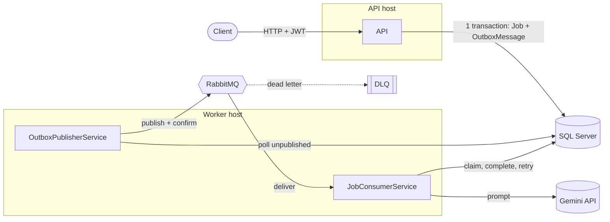
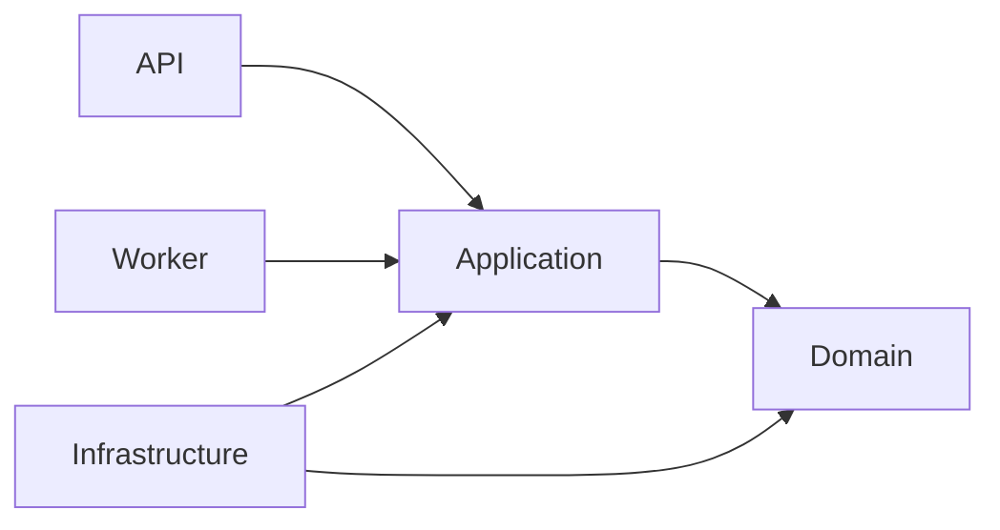
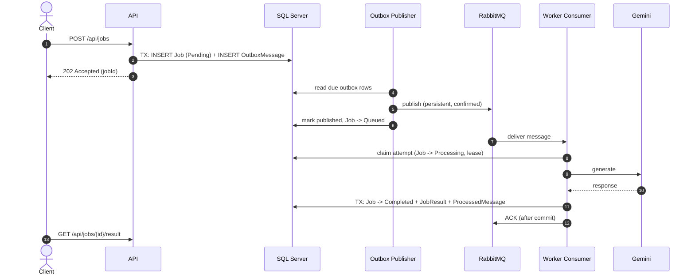
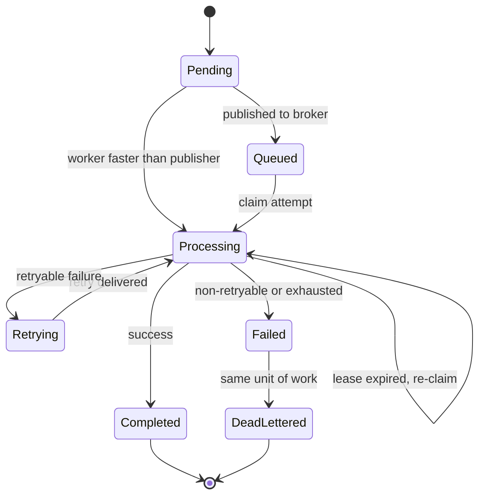

# AI Job Processing Platform

A reliable, asynchronous **AI job processing backend** built with **.NET**, **SQL Server**, **RabbitMQ** and the **Google Gemini API**.

Users submit text-processing jobs (summarization, classification) through a REST API. The API returns immediately, and a background **Worker** processes each job with an AI model — with a **Transactional Outbox**, **idempotent consumers**, **retries with exponential backoff**, a **Dead Letter Queue**, and safe handling of **concurrent workers**.


---

## Table of Contents

1. [Features](#features)
2. [Architecture](#architecture)
3. [How a job flows](#how-a-job-flows)
4. [Reliability design](#reliability-design)
5. [Job state machine](#job-state-machine)
6. [Tech stack](#tech-stack)
7. [Project structure](#project-structure)
8. [API reference](#api-reference)
9. [Configuration](#configuration)
10. [Getting started](#getting-started)
11. [Database design](#database-design)
12. [Design decisions](#design-decisions)
13. [Known limitations & future work](#known-limitations--future-work)

---

## Features

- **JWT authentication** — register / login, per-user job ownership.
- **Asynchronous jobs** — `POST /api/jobs` returns `202 Accepted`; no AI or broker call happens inside the HTTP request.
- **Two job types** — `summarization` and `classification` (extensible through `IJobTypeHandler`).
- **Transactional Outbox** — a job and its outbox message are saved in **one SQL transaction**, so a job is never lost if RabbitMQ is down.
- **Idempotent processing** — duplicate deliveries never produce duplicate results (`ProcessedMessages`, unique constraints).
- **Retry with exponential backoff + jitter** — retries are re-published through the Outbox with a future `AvailableAt` (no delay queues needed).
- **Dead Letter Queue** — non-retryable or exhausted jobs end as `DeadLettered` and their message lands in the DLQ.
- **Crash recovery** — a processing *lease* lets another worker safely take over a job if a worker dies mid-call.
- **Concurrency safe** — optimistic concurrency (`RowVersion`) + unique constraints; multiple workers can run side by side.
- **Structured logging** — Serilog JSON logs with a correlation ID that follows the request all the way through the broker and the worker.
- **Consistent errors** — every failure returns the same `ApiError` shape (`code`, `message`, `traceId`).

---

## Architecture

A **Modular Monolith** following **Clean Architecture**, deployed as two processes that share one codebase and one database.



### Dependency direction



| Layer | Responsibility |
|---|---|
| **Domain** | `User` and `Job` aggregates, the job state machine, invariants. No dependencies. |
| **Application** | Use-case handlers, ports (interfaces), validators, retry policy, job-type prompts and AI-output validation. |
| **Infrastructure** | EF Core + SQL Server, RabbitMQ connection/publisher/topology, Gemini HTTP client, JWT and password hashing. |
| **API** | HTTP endpoints, authentication, middleware (correlation ID, exception handling), validation filter. **Never talks to RabbitMQ or the AI provider.** |
| **Worker** | Outbox publisher loop and RabbitMQ consumer loop. |

---

## How a job flows



---

## Reliability design

| Concern | How it is solved |
|---|---|
| **Job lost if broker is down** | Transactional Outbox — publish happens later from the Worker, API only needs SQL Server. |
| **Duplicate delivery** | `ProcessedMessages` row is written in the **same transaction** as the business effect; PK on `MessageId` is the hard guard. |
| **Crash after commit, before ACK** | Redelivery finds the `ProcessedMessage` and is simply acknowledged. |
| **Crash before commit** | Message was never ACKed → redelivered and processed again safely. |
| **Two workers, same job** | `Jobs.RowVersion` optimistic concurrency + lease; the loser defers and acknowledges. |
| **Worker dies mid-AI-call** | Lease expires → a deferred message re-claims the job; the old attempt is marked `Abandoned`. |
| **Transient AI failures** | Timeout / network / 429 / 5xx / invalid AI output → retried with exponential backoff and jitter. |
| **Permanent failures** | Bad request / auth / unsupported type / attempts exhausted → `DeadLettered` + message to the DLQ. |
| **ACK correctness** | ACK/NACK is sent **only after** the database commit. |
| **Two results for one job** | Impossible: unique index on `JobResults.JobId` + state machine + `RowVersion`. |

> **Invariant:** every non-terminal job always has either an un-acked/ready RabbitMQ message or an unpublished (possibly delayed) outbox row — so jobs cannot get "stuck".

Retry flow in one sentence: on a retryable failure the Worker commits *Job → Retrying* **and** a new delayed outbox message **and** the idempotency record in a single transaction, then ACKs; the publisher sends the retry when its `AvailableAt` is reached.

---

## Job state machine



Transitions are enforced **only inside the `Job` aggregate**; handlers never assign `Status` directly.

---

## Tech stack

| Area | Technology |
|---|---|
| Runtime | .NET 10, ASP.NET Core Minimal APIs |
| Persistence | Entity Framework Core, SQL Server |
| Messaging | RabbitMQ (`RabbitMQ.Client` 7.x) |
| AI | Google Gemini API (`generateContent`, JSON response mode) via typed `HttpClient` |
| Auth | JWT Bearer (HS256), PBKDF2 password hashing |
| Validation | FluentValidation |
| Logging | Serilog (structured JSON) |
| Architecture | Clean Architecture, Modular Monolith, Transactional Outbox |

---

## Project structure

```text
src/
├── API/                          # HTTP host
│   ├── Endpoints/                # Auth + Jobs endpoints
│   ├── Filter/                   # Validation endpoint filter
│   ├── Infrastructure/           # API-side implementations (current user, correlation context, JWT setup)
│   ├── Middleware/               # Correlation ID, global exception handling
│   ├── appsettings.json
│   └── Program.cs
│
├── Application/                  # Use cases and ports
│   ├── AI/                       # IAiProvider, AiRequest/Response, AiErrorKind, exceptions
│   ├── Common/                   # Exceptions, IUnitOfWork, ApiError, abstractions
│   ├── Identity/                 # Register / Login handlers, validators, DTOs
│   ├── IRepositories/            # Repository and store interfaces
│   ├── Jobs/                     # Job handlers, job types, processing (ProcessJobMessageHandler, RetryPolicy)
│   ├── Messaging/                # OutboxMessage, ProcessedMessage, JobQueuedMessage, publish handler
│   └── DependencyInjection.cs
│
├── Domain/                       # No dependencies
│   ├── Common/                   # DomainException
│   ├── Identity/                 # User aggregate
│   └── Jobs/                     # Job aggregate, JobAttempt, JobResult, enums
│
├── Infrastructure/
│   ├── AI/                       # GeminiProvider, AiOptions
│   ├── Migrations/               # EF Core migrations
│   ├── Persistence/              # AppDbContext, configurations, repositories, queries
│   ├── Security/                 # Password hasher, JWT token service
│   └── Extention.cs              # Infrastructure DI registration
│
└── Worker/                       # Background host
    ├── Parser/                   # Message envelope parser / validation
    ├── Services/
    │   ├── OutboxPublisherService.cs   # polls outbox and publishes to RabbitMQ
    │   └── JobConsumerService.cs       # consumes messages, ACK/NACK mapping
    ├── Validator/                # Options validators
    ├── appsettings.json
    └── Program.cs
```

---

## API reference

All errors use the same body:

```json
{ "code": "job_not_found", "message": "Job not found.", "traceId": "a1b2c3…", "errors": null }
```

| Method | Endpoint | Auth | Description | Success |
|---|---|---|---|---|
| `POST` | `/api/auth/register` | – | Create an account | `201` |
| `POST` | `/api/auth/login` | – | Get a JWT | `200` |
| `POST` | `/api/jobs` | JWT | Create a job | `202` + `Location` |
| `GET` | `/api/jobs` | JWT | List my jobs (`status`, `type`, `page`, `pageSize`, `order`) | `200` |
| `GET` | `/api/jobs/{id}` | JWT | Job status, attempts, last error | `200` |
| `GET` | `/api/jobs/{id}/result` | JWT | AI result of a completed job | `200` |

Notable status codes: `400` validation, `401` unauthenticated / bad credentials, `404` job not found **or owned by another user** (prevents ID enumeration), `409` duplicate email or result not ready (`job_not_completed`) / job failed (`job_failed`).

### Example

```bash
# register + login
curl -X POST https://localhost:7000/api/auth/register -H "Content-Type: application/json" \
     -d '{"email":"me@example.com","password":"Passw0rd!x"}'
curl -X POST https://localhost:7000/api/auth/login -H "Content-Type: application/json" \
     -d '{"email":"me@example.com","password":"Passw0rd!x"}'

# create a job
curl -X POST https://localhost:7000/api/jobs \
     -H "Authorization: Bearer <token>" -H "Content-Type: application/json" \
     -d '{"type":"summarization","input":{"text":"Long text to summarize ..."}}'
# → 202 {"jobId":"…","status":"Pending"}

# poll status, then fetch the result
curl https://localhost:7000/api/jobs/<jobId>        -H "Authorization: Bearer <token>"
curl https://localhost:7000/api/jobs/<jobId>/result -H "Authorization: Bearer <token>"
# → {"jobId":"…","result":{"summary":"…"}}
```

Job types and their input/result:

| Type | Input | Result |
|---|---|---|
| `summarization` | `{ "text": "..." }` | `{ "summary": "..." }` |
| `classification` | `{ "text": "..." }` | `{ "category": "positive \| negative \| neutral" }` |

---

## Configuration

Secrets are **never** committed. Use `dotnet user-secrets` locally and environment variables in other environments (`__` is the section separator, e.g. `Ai__ApiKey`).

| Section | Host | Key settings |
|---|---|---|
| `ConnectionStrings:Default` | API + Worker | SQL Server connection string |
| `Jwt` | API | `Issuer`, `Audience`, `SigningKey` (≥ 32 chars), `AccessTokenMinutes` |
| `Jobs` | API + Worker | `MaxInputCharacters` |
| `Retry` | API + Worker | `MaxAttempts`, `BaseDelaySeconds`, `Multiplier`, `MaxDelaySeconds`, `JitterRatio` |
| `Processing` | Worker | `LeaseSeconds`, `MaxConcurrentJobs`, `RequeueDelaySeconds` |
| `Outbox` | Worker | `PollIntervalMilliseconds`, `BatchSize`, `MaxPublishBackoffSeconds` |
| `RabbitMq` | Worker | host, credentials, exchange/queue/routing keys, DLX/DLQ names |
| `Ai` | Worker | `BaseUrl`, `Model`, `ApiKey`, `TimeoutSeconds` |

Options are validated **at startup** — a missing signing key or invalid lease setting stops the process immediately instead of failing later. The API does not need any `RabbitMq` or `Ai` settings.

Example `Ai` section for Gemini:

```json
"Ai": {
  "Provider": "Gemini",
  "BaseUrl": "https://generativelanguage.googleapis.com/",
  "Model": "gemini-2.5-flash",
  "ApiKey": "",
  "TimeoutSeconds": 60
}
```

---

## Getting started

### Prerequisites

- [.NET 10 SDK](https://dotnet.microsoft.com/download)
- SQL Server (local instance, LocalDB or any reachable server)
- Docker (**only** used to run RabbitMQ)
- A Google Gemini API key

### 1. Start RabbitMQ

```bash
docker run -d --name rabbitmq \
  -p 5672:5672 -p 15672:15672 \
  -e RABBITMQ_DEFAULT_USER=app -e RABBITMQ_DEFAULT_PASS=app_pass \
  rabbitmq:3-management
```

Management UI: <http://localhost:15672> (`app` / `app_pass`). The Worker declares the exchange, queue, dead-letter exchange and DLQ automatically on startup.

### 2. Clone and configure secrets

```bash
git clone <your-repo-url>
cd <repo-folder>

# API
dotnet user-secrets init --project src/API
dotnet user-secrets set "ConnectionStrings:Default" "Server=localhost;Database=AiJobPlatform;Trusted_Connection=True;TrustServerCertificate=True" --project src/API
dotnet user-secrets set "Jwt:SigningKey" "<random string of at least 32 characters>" --project src/API

# Worker
dotnet user-secrets init --project src/Worker
dotnet user-secrets set "ConnectionStrings:Default" "Server=localhost;Database=AiJobPlatform;Trusted_Connection=True;TrustServerCertificate=True" --project src/Worker
dotnet user-secrets set "RabbitMq:Username" "app"      --project src/Worker
dotnet user-secrets set "RabbitMq:Password" "app_pass" --project src/Worker
dotnet user-secrets set "Ai:ApiKey" "<your Gemini API key>" --project src/Worker
```

### 3. Create the database

Migrations are applied **explicitly** (never automatically at startup, to avoid the two hosts racing):

```bash
dotnet tool install --global dotnet-ef   # once
dotnet ef database update -p src/Infrastructure -s src/API
```

### 4. Run both hosts

```bash
dotnet run --project src/API       # terminal 1
dotnet run --project src/Worker    # terminal 2
```

You can start more than one Worker; the design is safe with multiple instances.

---

## Database design

| Table | Purpose |
|---|---|
| `Users` | Accounts (unique normalized email) |
| `Jobs` | Job aggregate root: status, attempts, lease, `RowVersion` |
| `JobAttempts` | One row per execution attempt (`Started`, `Succeeded`, `Failed`, `Abandoned`) |
| `JobResults` | AI output, **unique per job** |
| `OutboxMessages` | Messages waiting to be published (`PublishedAt IS NULL`), including delayed retries (`AvailableAt`) |
| `ProcessedMessages` | Idempotency records (`MessageId` PK, `Outcome`) |

Key indexes (each justified by a real query):

- `IX_Jobs_UserId_CreatedAt (UserId, CreatedAt DESC, Id DESC) INCLUDE (Status, Type)` — job history with filters and paging.
- `IX_Outbox_Unpublished (AvailableAt) WHERE PublishedAt IS NULL` — a tiny filtered index for the publisher's one-second poll.
- `UX_JobResults_JobId`, `UX_JobAttempts_JobId_AttemptNumber`, `UX_Users_Email`, `PK_ProcessedMessages` — integrity and concurrency guards.

---

## Design decisions

- **Plain handler classes, no MediatR** — one class per use case, no extra framework.
- **The API never touches RabbitMQ or the AI provider** — job creation depends only on SQL Server, and the API holds no broker/AI secrets.
- **Messages carry IDs only** — job text and results stay in SQL Server, never in the broker or the DLQ.
- **Retries go through the Outbox** — retry intent is committed atomically with the state change; no TTL/delay queues.
- **No database transaction around the AI call** — two short transactions (claim, complete) instead.
- **Safe error strings** — `LastError` only contains application-authored messages; raw exceptions go to logs only.
- **Provider-agnostic AI layer** — `IAiProvider` isolates Gemini; switching providers means replacing one class.
- **Sensitive data is never logged** — passwords, tokens, API keys, job input and AI output are excluded from logs.

---

## Known limitations & future work

- No rate limiting on login and no refresh tokens.
- No retention cleanup for `ProcessedMessages` and published `OutboxMessages`.
- No tooling to re-drive messages from the DLQ.
- No background sweeper for stuck jobs (not needed by design, but could be added as a safety net).
- Registration reveals whether an email is already registered.
- If SQL Server fails right after a successful AI response, the AI call may be repeated (the stored result is never duplicated).

---


## Author

Osama Mohamed · [GitHub](https://github.com/OsamaMohamedM/)